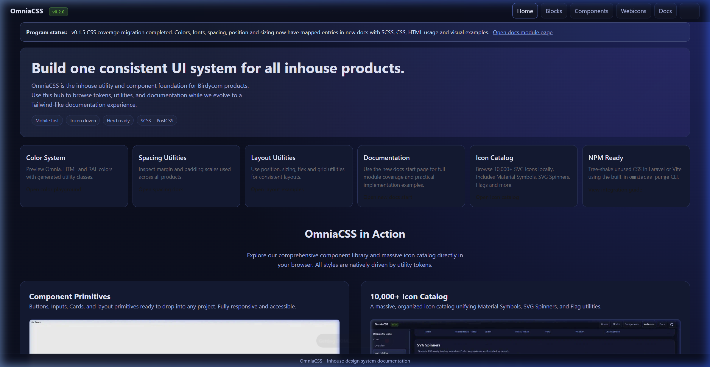

# OmniaCSS

Modern CSS als utility classes en kleurtokens — gegenereerd op maat van je project.

> **Componenten en blocks zitten sinds oktober 2026 in [OmniaUI](https://github.com/Birdycom/OmniaUI)** (`@birdycom/omniaui`, `@birdycom/omniaui-blocks`, React/Vue/Blade-wrappers, site: https://omniaui.eu). Deze repo bevat alleen het CSS-deel: utilities, tokens, SCSS, de on-demand engine, de CLI (`init` / `build` / `migrate`), `@birdycom/omniacss-migrate` en de CSS-docs (https://omniacss.eu). Beide repos houden **dezelfde versie** aan.

**Versie:** `0.11.0` — zelfde waarde in `package.json` en alle `@birdycom/omniacss*` packages (en in de OmniaUI-repo) (`MAJOR.MINOR.PATCH`).

## Recente wijzigingen

Nieuwste eerst. Bij een release: `npm run release -- <patch|minor|major> "omschrijving"` werkt deze tabel én `docs/release-history.json` bij.

| Versie | Datum | Wat |
|--------|-------|-----|
| `0.11.0` | 2026-10-24 | Docs doorzoeken met Ctrl K |
| `0.10.0` | 2026-10-23 | Bootstrap-sites omzetten naar OmniaCSS |
| `0.9.0` | 2026-10-23 | CSS-functies, units en selectors |
| `0.8.4` | 2026-10-23 | Basiskleuren in de docs als -100 |
| `0.8.3` | 2026-10-23 | README-beelden van IntelliSense als productshots |
| `0.8.2` | 2026-10-23 | Kleur-utilities tonen hun CSS in de completion |
| `0.8.1` | 2026-10-23 | Zelfde versie als OmniaUI: lockfile voor Linux CI |
| `0.8.0` | 2026-10-18 | OmniaCSS IntelliSense voor VS Code |
| `0.7.0` | 2026-10-16 | Zelfde versie als OmniaUI: lijsttabel en veldchrome |
| `0.6.0` | 2026-10-15 | OmniaCSS en OmniaUI gesplitst: componenten, blocks, wrappers en Laravel naar OmniaUI; npm-scope @birdycom |
| `0.5.0` | 2026-10-14 | Nieuwe components en app-blocks, docs-paginacheck, TOC en spacing-fixes |
| `0.4.0` | 2026-10-12 | npm packages @birdycom/omniacss, components, blocks, cli; on-demand build (12 MB → enkele KB); PostCSS plugin (`@omnia;`); light-dark() theming zonder JavaScript; CSS-first modal, dropdown, accordion, tabs, theme switch en counter; één oc-hero; docs als Astro static site; semver release workflow |
| `0.3.0` | 2026-10-12 | Moderne CSS utilities (anchor positioning, container queries, view transitions, scroll animations, gradients, logical properties, SVG); MDN coverage audit; browser support tabellen uit MDN browser-compat-data |
| `0.2.0` | 2026-04-09 | Component primitives en blocks, icon catalog, gestandaardiseerde docs-layout |
| `0.1.0` | 2026-03-20 | Baseline: SCSS utility framework met Omnia-, HTML- en RAL-kleuren (OKLCH), spacing, sizing, typografie, flex/grid en documentatie |

## Waarom OmniaCSS

- **De nieuwste CSS als klassen** — anchor positioning, container queries, view transitions, scroll-driven animations, `@starting-style`, `light-dark()`, gap decorations, `text-box`, `shape()` … Elke docs-pagina toont per feature de browsersupport (desktop + mobiel) uit MDN browser-compat-data.
- **On demand** — de CLI of PostCSS-plugin scant je project en levert alleen de klassen (en kleurtokens en webfonts) die je echt gebruikt: van 12 MB volledige build naar enkele KB.
- **Componenten in OmniaUI** — CSS-first componenten en blocks (modal, dropdown, tabs … zonder JavaScript) staan in de [OmniaUI](https://github.com/Birdycom/omniaui)-repo en gebruiken deze utilities en tokens.
- **Light/dark mode zonder JavaScript** — alle tokens zijn `light-dark(licht, donker)`; standaard volgt de pagina het besturingssysteem, `<html data-theme="light|dark">` of de theme switch overschrijft.
- **Cascade layers** — de uitvoer staat in `@layer omnia`, zodat je eigen CSS altijd wint zonder `!important`.

## Showcase



## Installeren in een project

Vereist Node.js 22 of nieuwer.

### 1. CLI (elk project: HTML, Laravel, PHP, statische sites)

```bash
npm install -D @birdycom/omniacss-cli
npx omniacss init                 # maakt omnia.config.json (herkent Laravel, Astro, Nuxt, Vite)
npx omniacss build --watch        # development
npx omniacss build --minify       # productie
```

```html
<link rel="stylesheet" href="/css/omnia.css">
```

`omnia.config.json`:

```json
{
  "content": ["resources/views/**/*.blade.php", "resources/js/**/*.{js,ts,vue,tsx}", "omnia/**/*.html"],
  "output": "public/css/omnia.css",
  "layer": "omnia",
  "minify": false
}
```

### 2. PostCSS-plugin (Vite, Laravel Vite, Next.js, Astro, webpack)

```bash
npm install -D @birdycom/omniacss
```

```js
// postcss.config.js
import omniacss from "@birdycom/omniacss/postcss";

export default {
  plugins: [omniacss({ content: ["resources/views/**/*.blade.php", "resources/js/**/*.{vue,tsx}"] })],
};
```

```css
/* resources/css/app.css */
@omnia;

.my-own-class { /* je eigen CSS wint van @layer omnia */ }
```

Vite herbouwt automatisch wanneer een content-bestand wijzigt.

### 3. Volledige build (prototypes)

```bash
npm install @birdycom/omniacss @birdycom/omniaui
```

```js
import "@birdycom/omniacss";          // alle utilities (groot — gebruik voor productie optie 1 of 2)
import "@birdycom/omniaui";          // componenten (OmniaUI, apart package)
```

SCSS-bronnen: `@birdycom/omniacss/scss/*`.

## Componenten en blocks

Verhuisd naar OmniaUI. Kopiëren in je project gaat nu met de `omniaui`-CLI:

```bash
npm install -D @birdycom/omniaui
npx omniaui add modal
npx omniaui add pricing --kind block
```

`omniacss build` neemt de OmniaUI-CSS automatisch mee als `@birdycom/omniaui` geïnstalleerd is (uitzetten: `--no-components`).

## Light en dark mode

```html
<html>                      <!-- volgt het besturingssysteem -->
<html data-theme="dark">    <!-- vast donker -->

<!-- Schakelaar, werkt met CSS (:has) — geen script nodig -->
<fieldset class="oc-theme-switch" aria-label="Thema">
  <label><input type="radio" name="oc-theme" value="system" checked> Systeem</label>
  <label><input type="radio" name="oc-theme" value="light"> Licht</label>
  <label><input type="radio" name="oc-theme" value="dark"> Donker</label>
</fieldset>
```

Utilities met `dark:`-prefix blijven werken (`.dark` of `data-theme="dark"`).

## Packages

| Package | Inhoud |
|---------|--------|
| `@birdycom/omniacss` | Utilities (`dist/omnia.css`), kleurtokens, SCSS-bronnen, on-demand engine (`/engine`), PostCSS-plugin (`/postcss`) |
| `@birdycom/omniacss-cli` | `omniacss init / build / migrate` (bin `omniacss`) |
| `@birdycom/omniacss-migrate` | Tailwind CSS → OmniaCSS: PostCSS/Vite-plugin, scan, setup, codemod |

Componenten, blocks en framework-wrappers: zie [OmniaUI](https://github.com/Birdycom/omniaui).

## Ontwikkelen aan OmniaCSS

```bash
npm install
npm run build        # SCSS → CSS → packages → browser-data → docs-site in public/
npm run docs:dev     # docs met live reload (Astro)
npm run docs:build   # alleen de docs-site opnieuw bouwen
npm run docs:check   # controleert de /docs-pagina's (browser support + bronvermelding)
npm run sync:omniaui # ververs de OmniaUI-CSS in public/css uit ../omniaUI (na een build daar)
```

Structuur:

```
src/scss/                 utilities (SCSS-bron)
packages/core             engine + PostCSS-plugin + build-uitvoer
packages/cli              bin/omniacss.mjs
packages/migrate          Tailwind → OmniaCSS migratie
apps/docs                 Astro docs-site
  src/content/            de pagina's (gewone HTML met <oc-demo>, <oc-code>, <oc-compat>)
  src/layouts, src/lib    layout, build-time highlighter, navigatie, browsertabellen
public/                   gebouwde site (Herd: https://omniacss.test)
public/css/oc-components.css, oc-blocks.css, oc-code-syntax.css
                          gevendorde OmniaUI-CSS voor de docs-shell en demo's (npm run sync:omniaui)
docs/release-history.json versiehistoriek
```

Docs-pagina schrijven (`apps/docs/src/content/...html`):

```html
<oc-demo title="Clip path">
  <div class="clip-circle size-24 bg-dodgerblue-90"></div>
</oc-demo>                                   <!-- code wordt uit de demo gegenereerd -->

<oc-code lang="css">.my-rule { color: red; }</oc-code>

<oc-compat features="css.properties.clip-path css.types.basic-shape.shape"></oc-compat>
```

Bij de build worden demo's, gekleurde Code-blocks (regelnummers + Omnia-thema), browsertabellen, zijbalken en "On this page" als statische HTML gerenderd — de site laadt geen JavaScript behalve één regel die de themakeuze onthoudt.

## Versiebeheer

Zelfde werkwijze als OmniaDesk, met npm-semver (`MAJOR.MINOR.PATCH`):

| Wijziging | Commando |
|-----------|----------|
| Bugfix, polish | `npm run release -- patch "omschrijving"` |
| Nieuwe utilities of docs-pagina | `npm run release -- minor "omschrijving"` |
| Breaking change | `npm run release -- major "omschrijving"` |

Commit-onderwerp: `<type>: [vX.Y.Z] - <korte omschrijving>`. Regels: `.cursor/rules/omniacss-versioning.mdc`. OmniaUI volgt hetzelfde versienummer.

Publiceren: `npm run build && npm publish --workspaces --access public` (apps/docs is private en wordt overgeslagen).

## Licentie

MIT — Serge Cools (Birdycom).
