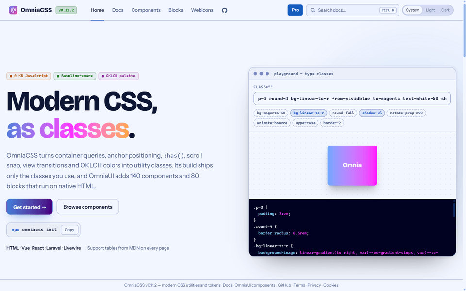
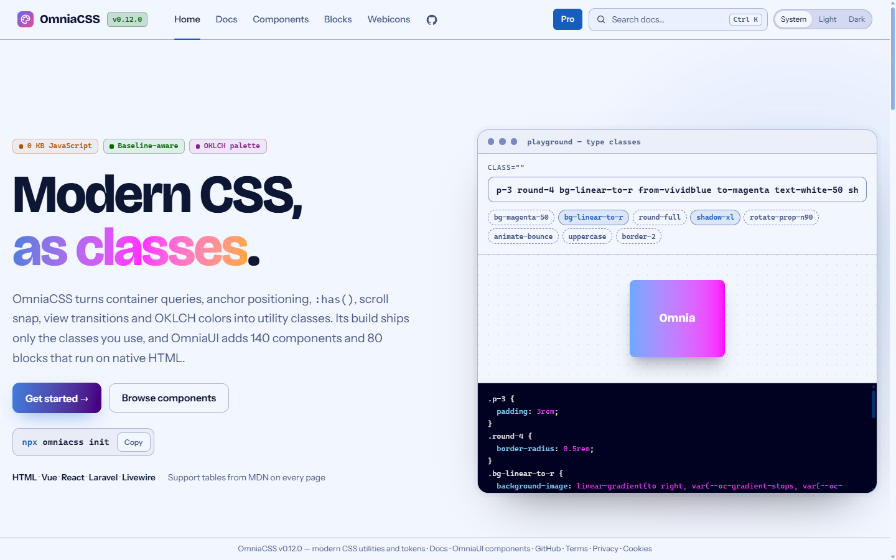
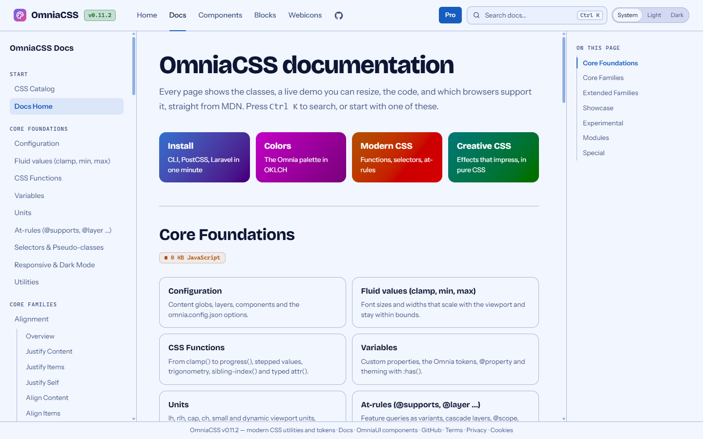
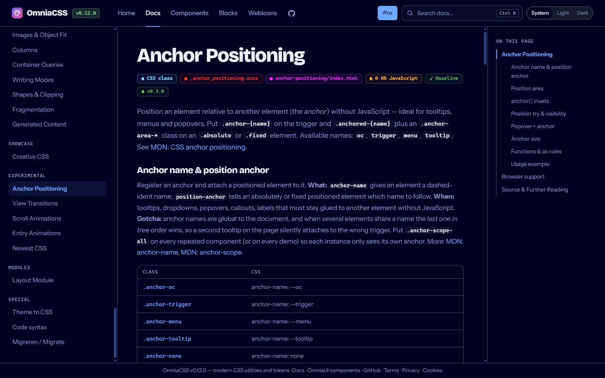
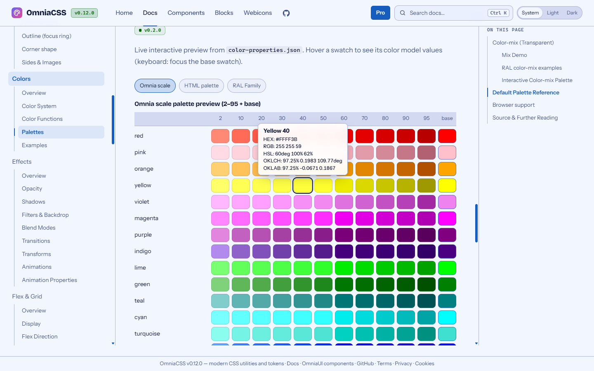

# OmniaCSS

Modern CSS as utility classes and color tokens, generated for exactly what your project uses.

[](LICENSE)
[](https://www.npmjs.com/package/@birdycom/omniacss)
[](https://github.com/Birdycom/OmniaCSS/actions/workflows/ci.yml)
[](https://github.com/Birdycom/OmniaCSS/actions/workflows/release.yml)
[](https://github.com/Birdycom/OmniaCSS/pulls)

**Docs:** https://omniacss.eu · **Components and blocks:** [OmniaUI](https://github.com/Birdycom/OmniaUI) (https://omniaui.eu)
· **Editor:** [OmniaCSS IntelliSense](packages/vscode) for VS Code and Cursor ([docs](https://omniacss.eu/docs/editor))
· **AI assistants:** [OmniaCSS MCP server](packages/mcp) for Claude, Cursor, Copilot and others

> Since October 2026 the components and blocks live in [OmniaUI](https://github.com/Birdycom/OmniaUI)
> (`@birdycom/omniaui`, `@birdycom/omniaui-blocks`, React, Vue and Blade wrappers). This repository holds the CSS
> part: utilities, tokens, SCSS, the on-demand engine, the CLI (`init` / `build` / `migrate` / `tokens`),
> `@birdycom/omniacss-migrate` and the CSS docs. Both repositories share the **same version number**.

**Version:** `0.12.1` — the same value in `package.json`, every `@birdycom/omniacss*` package and the OmniaUI repository (`MAJOR.MINOR.PATCH`).

## Why OmniaCSS

- **The newest CSS as classes** — anchor positioning, container queries, view transitions, scroll-driven animations,
  `@starting-style`, `light-dark()`, gap decorations, `text-box`, `shape()` … Every docs page shows browser support
  (desktop and mobile) per feature, from MDN browser-compat-data.
- **On demand** — the CLI or the PostCSS plugin scans your project and ships only the classes (and color tokens and
  web fonts) you actually use: from a 12 MB full build down to a few KB.
- **Components in OmniaUI** — CSS-first components and blocks (modal, dropdown, tabs … without JavaScript) live in
  [OmniaUI](https://github.com/Birdycom/OmniaUI) and use these utilities and tokens.
- **Light and dark mode without JavaScript** — every token is `light-dark(light, dark)`; by default the page follows
  the operating system, and `<html data-theme="light|dark">` or the theme switch overrides it.
- **Cascade layers** — the output sits in `@layer omnia`, so your own CSS always wins without `!important`.

## Showcase

A short tour: the homepage, the docs overview, a docs page (classes, live demo, code, browser support), the color
palettes with their values on hover, and the search dialog (<kbd>Ctrl</kbd> <kbd>K</kbd>).



| | |
|---|---|
|  |  |
| Homepage | Docs overview: every CSS family with its pages |
|  |  |
| A docs page in dark mode | Color palettes: hover a swatch for HEX, RGB, HSL, OKLCH and OKLAB |

Components and blocks are shown in the [OmniaUI README](https://github.com/Birdycom/OmniaUI#showcase).

## Install in a project

Requires Node.js 22 or newer.

### 1. CLI (any project: HTML, Laravel, PHP, static sites)

```bash
npm install -D @birdycom/omniacss-cli
npx omniacss init                 # creates omnia.config.json (detects Laravel, Astro, Nuxt, Vite)
npx omniacss build --watch        # development
npx omniacss build --minify       # production
```

```html
<link rel="stylesheet" href="/css/omnia.css">
```

`omnia.config.json` ([schema](https://omniacss.eu/schema/omnia.config.json)):

```json
{
  "$schema": "https://omniacss.eu/schema/omnia.config.json",
  "content": ["resources/views/**/*.blade.php", "resources/js/**/*.{js,ts,vue,tsx}", "omnia/**/*.html"],
  "output": "public/css/omnia.css",
  "layer": "omnia",
  "minify": false
}
```

### 2. PostCSS plugin (Vite, Laravel Vite, Next.js, Astro, webpack)

```bash
npm install -D @birdycom/omniacss
```

```js
// postcss.config.js
import omniacss from "@birdycom/omniacss/postcss";

export default {
  plugins: [omniacss({ content: ["resources/views/**/*.blade.php", "resources/js/**/*.{vue,tsx}"] })],
};
```

```css
/* resources/css/app.css */
@omnia;

.my-own-class { /* your own CSS wins over @layer omnia */ }
```

Vite rebuilds automatically when a content file changes.

### 3. Full build (prototypes)

```bash
npm install @birdycom/omniacss @birdycom/omniaui
```

```js
import "@birdycom/omniacss";   // every utility (large: use option 1 or 2 in production)
import "@birdycom/omniaui";    // components (OmniaUI, separate package)
```

SCSS sources: `@birdycom/omniacss/scss/*`.

### Coming from Tailwind CSS or Bootstrap?

```bash
npx omniacss migrate scan            # Tailwind CSS: what can be converted, keeping your class names
npx omniacss migrate bootstrap scan  # Bootstrap 3, 4 or 5
```

See the [migration guide](https://omniacss.eu/docs/migrate.html).

## Components and blocks

These moved to OmniaUI. Copy them into your project with the `omniaui` CLI:

```bash
npm install -D @birdycom/omniaui
npx omniaui add modal
npx omniaui add pricing --kind block
```

`omniacss build` includes the OmniaUI CSS automatically when `@birdycom/omniaui` is installed (turn it off with `--no-components`).

## Light and dark mode

```html
<html>                      <!-- follows the operating system -->
<html data-theme="dark">    <!-- always dark -->

<!-- Switch, works with CSS (:has) — no script needed -->
<fieldset class="oc-theme-switch" aria-label="Theme">
  <label><input type="radio" name="oc-theme" value="system" checked> System</label>
  <label><input type="radio" name="oc-theme" value="light"> Light</label>
  <label><input type="radio" name="oc-theme" value="dark"> Dark</label>
</fieldset>
```

Utilities with the `dark:` prefix keep working (`.dark` or `data-theme="dark"`).

## Packages

| Package | Contents |
|---------|----------|
| `@birdycom/omniacss` | Utilities (`dist/omnia.css`), color tokens, SCSS sources, on-demand engine (`/engine`), PostCSS plugin (`/postcss`) |
| `@birdycom/omniacss-cli` | `omniacss init / build / migrate / tokens` (bin `omniacss`) |
| `@birdycom/omniacss-migrate` | Tailwind CSS → OmniaCSS: PostCSS/Vite plugin, scan, setup, codemod |
| `@birdycom/omniacss-mcp` | [MCP server](packages/mcp) for AI assistants: check classes, OmniaUI components with their HTML, variants, tokens and docs, convert Tailwind classes |

Components, blocks and framework wrappers: see [OmniaUI](https://github.com/Birdycom/OmniaUI).

## Working on OmniaCSS

```bash
npm install
npm run build        # SCSS → CSS → packages → browser data → docs site in public/
npm run docs:dev     # docs with live reload (Astro)
npm run docs:build   # rebuild only the docs site
npm run docs:check   # checks the /docs pages (browser support and sources)
npm run sync:omniaui # refresh the OmniaUI CSS in public/css from ../omniaUI (after a build there)
```

Structure:

```
src/scss/                 utilities (SCSS source)
packages/core             engine + PostCSS plugin + build output
packages/cli              bin/omniacss.mjs
packages/migrate          Tailwind → OmniaCSS migration
packages/vscode           OmniaCSS IntelliSense for VS Code and Cursor
apps/docs                 Astro docs site
  src/content/            the pages (plain HTML with <oc-demo>, <oc-code>, <oc-compat>)
  src/layouts, src/lib    layout, build-time highlighter, navigation, browser tables
public/                   built site (local: https://omniacss.test with Laravel Herd)
public/css/oc-components.css, oc-blocks.css, oc-code-syntax.css
                          vendored OmniaUI CSS for the docs shell and demos (npm run sync:omniaui)
docs/release-history.json version history
```

Writing a docs page (`apps/docs/src/content/...html`):

```html
<oc-demo title="Clip path">
  <div class="clip-circle size-24 bg-dodgerblue-90"></div>
</oc-demo>                                   <!-- the code is generated from the demo -->

<oc-code lang="css">.my-rule { color: red; }</oc-code>

<oc-compat features="css.properties.clip-path css.types.basic-shape.shape"></oc-compat>
```

At build time, demos, highlighted code blocks (line numbers and the Omnia theme), browser tables, sidebars and
"On this page" are rendered as static HTML. The site loads no JavaScript except one line that remembers the theme.

## Versioning and releases

Semantic versioning (`MAJOR.MINOR.PATCH`):

| Change | Command |
|--------|---------|
| Bug fix, polish | `npm run release -- patch "description"` |
| New utilities or docs page | `npm run release -- minor "description"` |
| Breaking change | `npm run release -- major "description"` |

The command updates every `package.json`, this README and `docs/release-history.json`.
Commit subject: `<type>: [vX.Y.Z] - <short description>`. OmniaUI follows the same version number.

Publishing: push a tag (`git tag v0.11.1 && git push origin v0.11.1`). The release workflow builds, tests and
publishes to npm with Trusted Publishing. Publish OmniaCSS before OmniaUI, which depends on it.

## Recent changes

Newest first.

| Version | Date | Changes |
|--------|-------|-----|
| `0.12.1` | 2026-10-29 | MCP met OmniaUI-componenten en -blocks; migrate-fixes (setup-versie, scroll-m/p, Vite-waarschuwing, eigen @import); extensie stil in Tailwind-projecten |
| `0.12.0` | 2026-10-28 | Tooltip met anchor positioning, titel en plaatsing; Pro-blocks infinite carousel en pricing plans; carousel-lus; schone URL's; favicons en SEO; lightbox- en kleurfixes |
| `0.11.2` | 2026-10-28 | mobiel site-header-menu, leesbare accenttekst in dark mode, minify behoudt scroll-animaties |
| `0.11.1` | 2026-10-28 | docs layout, browser support and demo fixes |
| `0.11.0` | 2026-10-24 | Search the docs with Ctrl K |
| `0.10.0` | 2026-10-23 | Convert Bootstrap sites to OmniaCSS |
| `0.9.0` | 2026-10-23 | CSS functions, units and selectors |
| `0.8.4` | 2026-10-23 | Base colors in the docs as -100 |
| `0.8.3` | 2026-10-23 | IntelliSense README images as product shots |
| `0.8.2` | 2026-10-23 | Color utilities show their CSS in completions |
| `0.8.1` | 2026-10-23 | Same version as OmniaUI: lockfile for Linux CI |
| `0.8.0` | 2026-10-18 | OmniaCSS IntelliSense for VS Code |
| `0.7.0` | 2026-10-16 | Same version as OmniaUI: list table and field chrome |
| `0.6.0` | 2026-10-15 | OmniaCSS and OmniaUI split: components, blocks, wrappers and Laravel moved to OmniaUI; npm scope @birdycom |
| `0.5.0` | 2026-10-14 | New components and app blocks, docs page check, TOC and spacing fixes |
| `0.4.0` | 2026-10-12 | npm packages; on-demand build (12 MB → a few KB); PostCSS plugin (`@omnia;`); light-dark() theming without JavaScript; CSS-first modal, dropdown, accordion, tabs, theme switch and counter; docs as an Astro static site; semver release workflow |
| `0.3.0` | 2026-10-12 | Modern CSS utilities (anchor positioning, container queries, view transitions, scroll animations, gradients, logical properties, SVG); MDN coverage audit; browser support tables from MDN browser-compat-data |
| `0.2.0` | 2026-04-09 | Component primitives and blocks, icon catalog, standardized docs layout |
| `0.1.0` | 2026-03-20 | Baseline: SCSS utility framework with Omnia, HTML and RAL colors (OKLCH), spacing, sizing, typography, flex/grid and documentation |

## License

MIT — Serge Cools (Birdycom).
