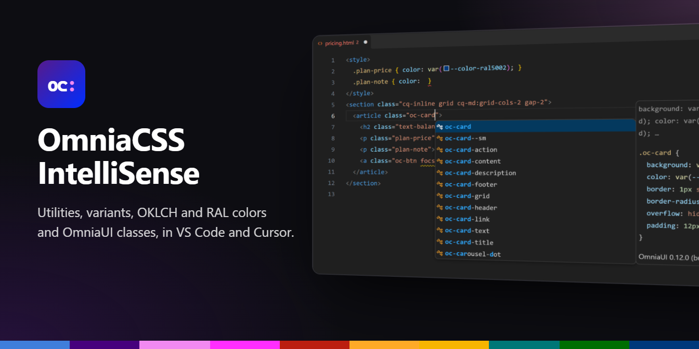
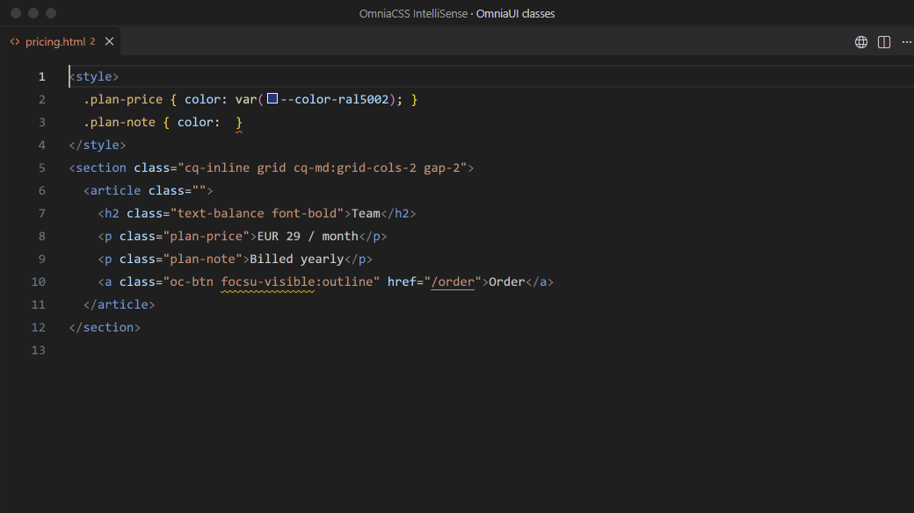
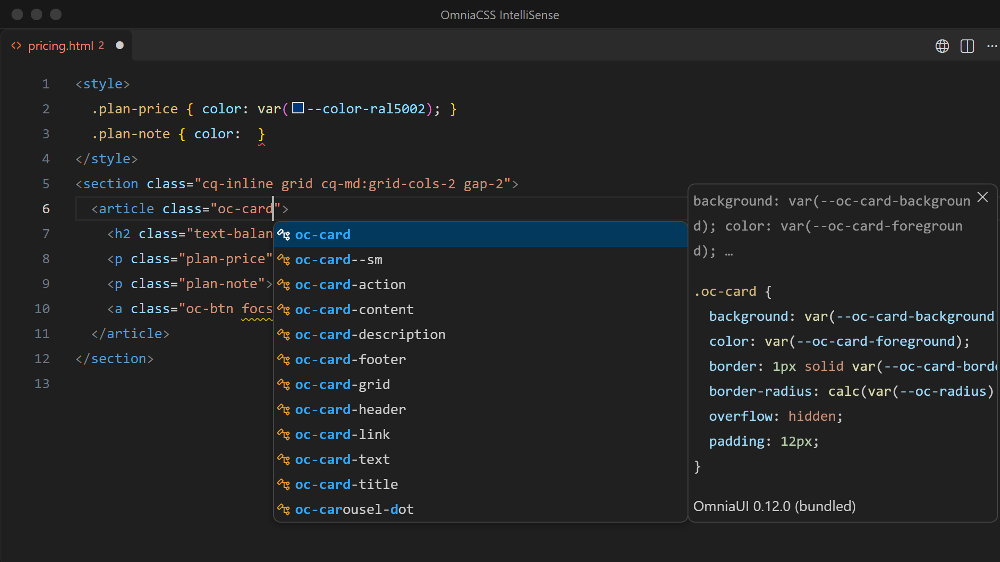
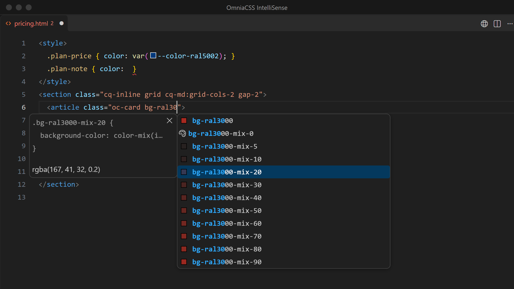
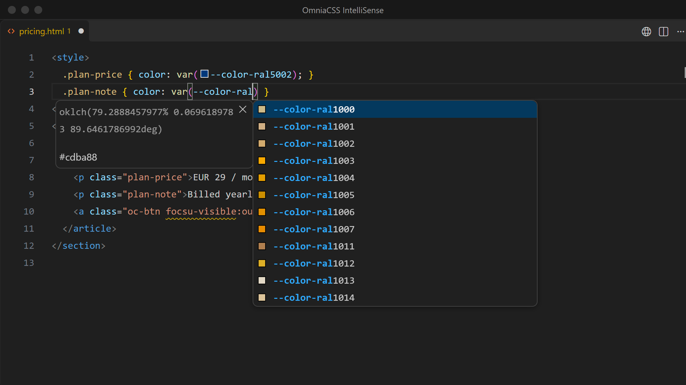
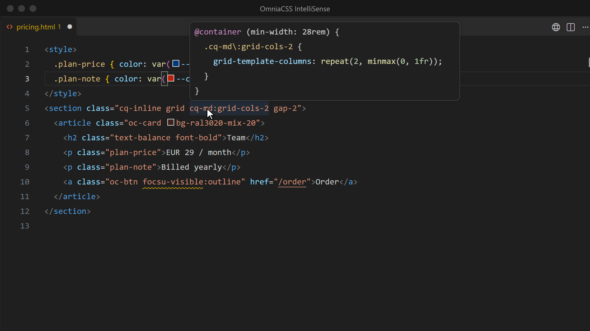
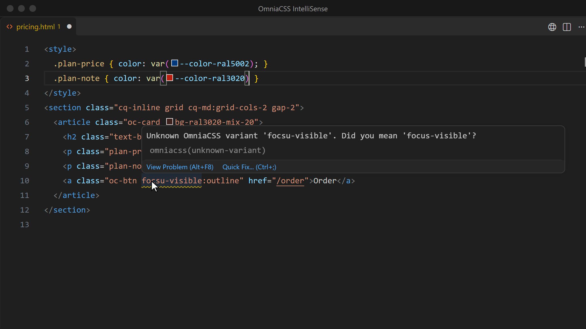

**OmniaCSS IntelliSense** knows the whole of [OmniaCSS](https://omniacss.eu) and [OmniaUI](https://omniaui.eu): every utility and variant, the Omnia, HTML and RAL colors with their mix steps, the color tokens, and the OmniaUI component and block classes. While you type it suggests them, shows the CSS they produce and points out typos. It runs in **VS Code**, **Cursor** and the other editors built on VS Code.



## Get it

| Editor | Where |
|---|---|
| VS Code | [VS Code Marketplace](https://marketplace.visualstudio.com/items?itemName=Birdycom.omniacss-intellisense), or *OmniaCSS IntelliSense* in the Extensions view |
| Cursor, VSCodium, Windsurf | [Open VSX](https://open-vsx.org/extension/Birdycom/omniacss-intellisense), the same search in the Extensions view |

There is no setup: no config file and nothing to install in your project. The version follows `@birdycom/omniacss`, and the editor installs updates by itself. Docs: [omniacss.eu/docs/editor](https://omniacss.eu/docs/editor).

## What it does

### 1. OmniaUI component and block classes

Type `oc-` and you get every OmniaUI class (`oc-card`, `oc-btn--outline`, `oc-tooltip__title`, `oc-block-…`) with the rules behind it: the class's own rule first, then its media queries and the places it is used in.



The classes follow your project:

- **Nothing installed** (CDN links, `@omniacss` in Laravel): the free OmniaUI classes the extension was built with.
- **`@birdycom/omniaui`, `-blocks` or `-pro` in `node_modules`** (also higher up in a monorepo): the classes and CSS of the version you installed. After `npm install` or an upgrade the list follows within a few seconds.
- **OmniaUI Pro** classes only appear where Pro is installed; the extension itself contains no Pro code.

### 2. Utilities, variants and colors

Every utility, with its CSS in the details panel, and every variant: states (`hover:`, `focus-visible:`), container queries (`cq-md:`), `dark:`, `group-hover/card:`, `has-checked:`, `aria-…:` and the bracket forms (`data-[state=open]:`, `supports-[…]:`). Picking a variant opens the list again for the utility.

Color classes show their swatch, also for the **RAL colors and their mix steps** (`bg-ral3020-mix-20`).



### 3. Color tokens in CSS

Inside `var(` you get every Omnia token (`--color-ral3020`, `--color-indigo-60` …) with its OKLCH value and sRGB fallback. Tokens get a swatch in CSS, SCSS, Less, `<style>` blocks and templates. In the color picker, the class or token you change snaps to the **nearest Omnia color**, so no stray hex value ends up in your code.



### 4. The CSS on hover

Hover a class to see the rule exactly as `omniacss build` writes it, variants included: `cq-md:grid-cols-2` shows the `@container` block, `md:hover:bg-red-50` the media query and `:hover`. rem values get a px comment; colors show their token and sRGB value.



### 5. Typos caught while you type

With a quick fix (<kbd>Ctrl</kbd> <kbd>.</kbd>, <kbd>Cmd</kbd> <kbd>.</kbd> on macOS) for each:

| Problem | Example | Setting |
|---|---|---|
| Unknown variant | `focsu-visible:outline` → *Did you mean 'focus-visible'?* | `omniacss.lint.unknownVariant` |
| Variant on something that is not a utility | `hover:bg-rde-50` generates no CSS | `omniacss.lint.unknownUtility` |
| The same class twice | `p-2 flex p-2` | `omniacss.lint.duplicateClass` |
| Any class that is neither OmniaCSS nor OmniaUI (off by default) | `my-own-class` | `omniacss.lint.unknownClass` |



## Where it looks for classes

| In | For example |
|---|---|
| Attributes | `class`, `className`, `class:list`, `:class`, `v-bind:class`, `x-bind:class`, `ngClass`, `[class]` |
| Expressions inside them | `:class="{ 'p-2': on }"`, `className={cn("flex", on && "gap-1")}`, template literals |
| Helper calls | `clsx()`, `cn()`, `cx()`, `cva()`, `classNames()`, Blade `@class([…])`, `classList.add()` |

File types: HTML, PHP and Blade, Vue, Svelte, Astro, JSX/TSX, Markdown/MDX, Twig, Handlebars, ERB, Django/Jinja, Liquid, Razor and more, plus CSS, SCSS, Sass and Less for the tokens. Other languages: add their id to `omniacss.includeLanguages`.

## Settings

| Setting | Default | What it changes |
|---|---|---|
| `omniacss.enable` | `true` | Turn the extension off for a workspace or folder. |
| `omniacss.classAttributes` | see above | Attributes that hold classes. |
| `omniacss.classFunctions` | `clsx`, `cn`, `cx`, `cva`, `classNames`, `classnames`, `@class` | Calls whose strings hold classes; add your own helpers. |
| `omniacss.includeLanguages` | `[]` | Extra language ids (reload the window after a change). |
| `omniacss.colorDecorators` | `true` | Swatches and the color picker. |
| `omniacss.showPixelEquivalents` | `true` | px comments next to rem values. |
| `omniacss.rootFontSize` | `16` | The root font size behind those px values. |
| `omniacss.lint.*` | `warning` (`unknownClass`: `ignore`) | `ignore`, `hint`, `info`, `warning` or `error`. |

Two editor settings help:

```jsonc
// settings.json
{
  // Suggestions on every keystroke inside class strings (the extension already opens them on " ' space : -)
  "editor.quickSuggestions": { "strings": "on" },
  // Hover shows the CSS; the color picker opens when you click the swatch
  "editor.colorDecoratorsActivatedOn": "click"
}
```

Blade files work as `php`, or as `blade` with a Blade extension installed.

## When something is missing

- **No list inside a string:** press <kbd>Ctrl</kbd> <kbd>Space</kbd> or turn on `editor.quickSuggestions` for strings.
- **Nothing in a file:** check the language in the status bar and add it to `omniacss.includeLanguages`.
- **Classes in your own attribute or helper:** add it to `omniacss.classAttributes` or `omniacss.classFunctions`.
- **Wrong OmniaUI version:** run **OmniaCSS: Show Output**. It lists the OmniaCSS index and which OmniaUI packages were found (installed or bundled). Include that output when you [open an issue](https://github.com/Birdycom/OmniaCSS/issues).

## Under the hood

The extension carries an index of the full OmniaCSS build and the engine's own variant module, so a variant's CSS is derived exactly like `omniacss build` and the PostCSS plugin do it. OmniaUI classes come from a bundled copy of the free stylesheets, or from `node_modules/@birdycom/omniaui*/dist/*.css` in your workspace. Those stylesheets are the only project files it reads; nothing runs in your project and nothing is sent anywhere.

## Building it yourself

From the root of the OmniaCSS repository:

```bash
npm run build:packages   # packages/core/dist, the full build the index is made from
npm run vscode:package   # index + .vsix in packages/vscode
npm run vscode:test      # tests
```

Install the `.vsix` with **Extensions: Install from VSIX…** or `code --install-extension packages/vscode/omniacss-intellisense-<version>.vsix` (`cursor --install-extension …` for Cursor).

The pictures and the demo are recorded in real VS Code with the extension loaded: `npm install --prefix packages/vscode && npm run media --prefix packages/vscode`. This needs VS Code, plus Chrome or Edge for the framing and the icon; set `VSCODE_PATH` when VS Code is not in its default place.

MIT © Serge Cools (Birdycom)
